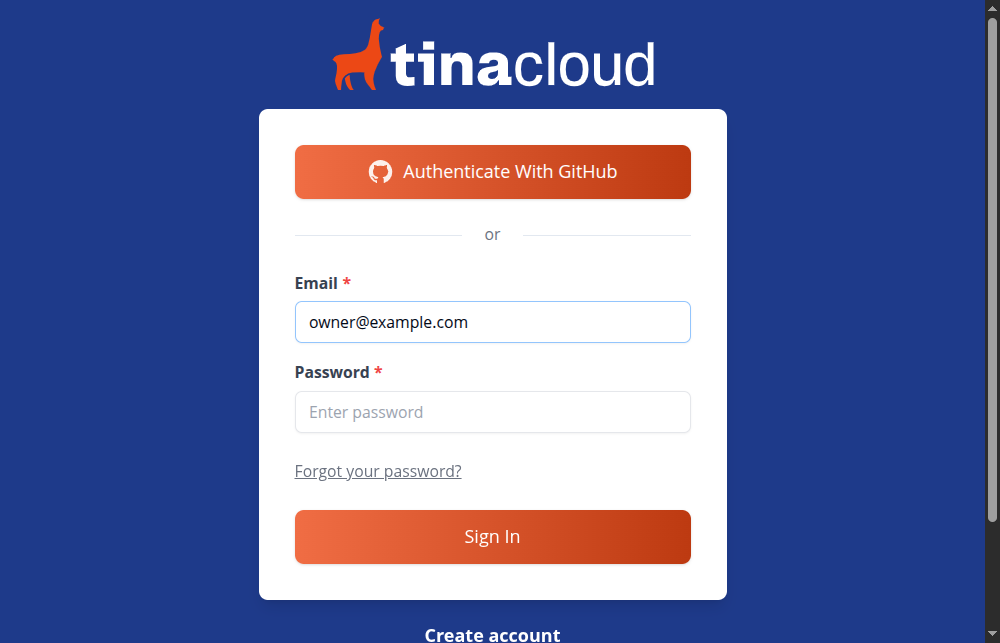
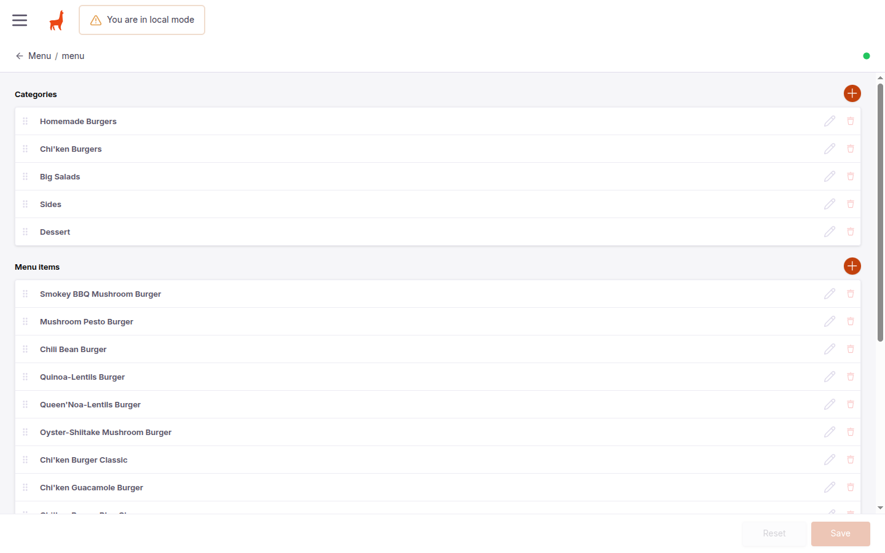
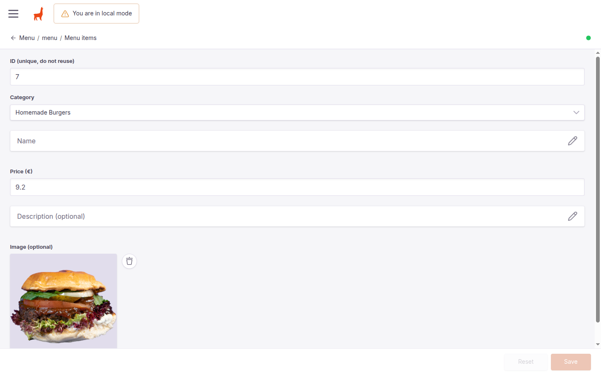
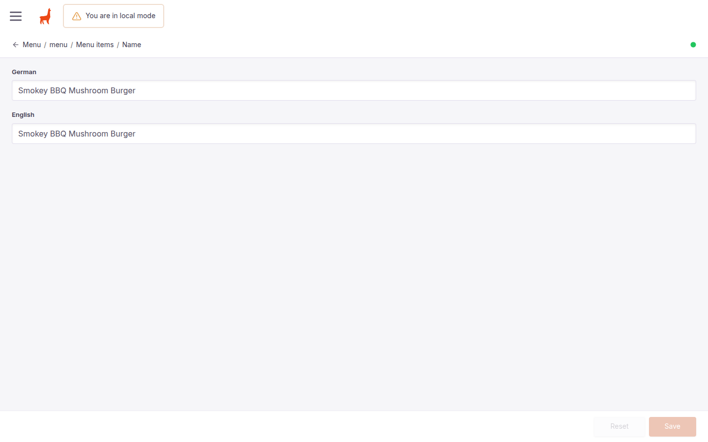
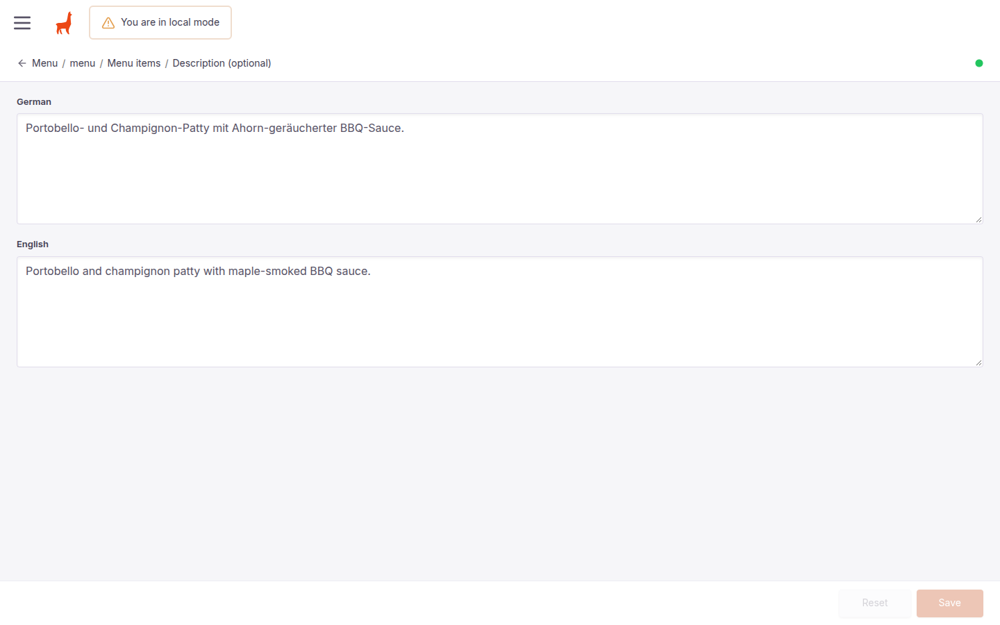
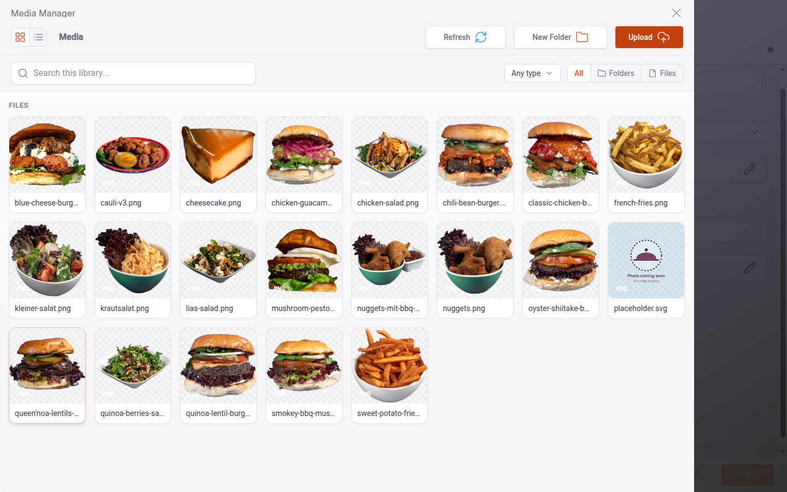

# Lia’s Kitchen — Website Update & Menu Management Guide

*Prepared for the Lia’s Kitchen team*  
**Date:** October 2026  
**Staging Preview Link:** [https://liaskitchen-three.vercel.app](https://liaskitchen-three.vercel.app)  

---

## 1. Welcome & Staging Website Review

Hello Lia’s Kitchen team! 👋

We have updated the website with your latest 2026 menu, updated prices, newly introduced dishes, and refined food photography.

Before we push these changes to your main domain (`liaskitchen.de`), we have deployed a **staging website** for you to explore and test:

👉 **Staging Link:** [https://liaskitchen-three.vercel.app](https://liaskitchen-three.vercel.app)

### What to check:
Please take a few minutes on both your **phone** and your **computer** to check:
- [ ] **Prices:** Confirm all item prices match your current in-store prices.
- [ ] **Descriptions (German & English):** Switch between **DE** and **EN** at the top of the site to review item names and descriptions.
- [ ] **Categories & Notes:** Verify that the dishes are in the right categories and that category notes (e.g. dips policy, bun types, extras) read correctly.
- [ ] **Photos:** Check how the new dishes and photos look on the page.

If you spot any typos, price adjustments, or missing details, please let us know so we can adjust them right away!

---

## 2. Summary of Changes Made to the Menu & Photos

### A. New Menu Categories & Notes
To make the menu easier for customers to browse, the dishes are now structured into 5 distinct categories, with helpful notes at the top of each section:

1. **Hausgemachte Burger / Homemade Burgers**  
   *Header note:* "Serviert im Brioche-Brötchen mit veganer Mayo, Salat & Gemüse. Extras: 'NoKäse' / Jalapeños — 1,00 €" / *"Served in a brioche bun with vegan mayo, lettuce & veggies. Extras: cheeze or jalapeños — 1,00 €"*
2. **Chi'ken Burgers**  
   *Header note:* "Unsere Chi'ken-Burger werden aus hausgemachtem Seitan zubereitet und im Brioche-Brötchen mit veganer Mayo und Rucola serviert." / *"Our Chi'ken burgers are made with homemade seitan and served in a brioche bun with vegan mayo and rocket."*
3. **Große Salate / Big Salads**
4. **Beilagen / Sides**  
   *Header note:* "Dips: Mayo / Aioli / Ketchup / BBQ / BBQ-Senf (2 pro Gericht)" / *"Dips: mayo / aioli / ketchup / BBQ / BBQ-Mustard (2 per dish)"*
5. **Dessert**

---

### B. New Dishes Added
We added two brand new items to the menu:
- **Mushroom Pesto Burger (€10.90):** Portobello- and champignon patty with roasted tomatoes, vegan mozzarella & pesto sauce.
- **Cheesecake (€4.50):** Homemade vegan cheesecake under the new Dessert section.

---

### C. 2026 Price & Item Updates
Here is the complete overview of updated prices and items matching your current printed menu:

| Category | Item Name | Old Price | Updated 2026 Price | Notes / Changes |
| :--- | :--- | :---: | :---: | :--- |
| **Burgers** | Smokey BBQ Mushroom Burger | €8.50 | **€9.20** | Updated description & price |
| **Burgers** | Mushroom Pesto Burger | — | **€10.90** | **New dish** |
| **Burgers** | Chili Bean Burger | €8.00 | **€8.80** | Updated description & price |
| **Burgers** | Quinoa-Linsen Burger | €9.50 | **€9.90** | Updated price |
| **Burgers** | Queen Noa Linsen Burger | €10.50 | **€10.90** | Updated price |
| **Burgers** | Oyster & Shiitake Mushroom Burger | €9.50 | **€9.90** | Updated description & price |
| **Chi'ken** | Chi'ken Burger Classic | €9.50 | **€9.90** | Updated description & price |
| **Chi'ken** | Chi'ken Guacamole Burger | €9.50 | **€9.90** | Updated price |
| **Chi'ken** | Chi'ken Burger Blue Cheeze | €9.50 | **€9.90** | Updated description & price |
| **Salads** | Quinoa, Beeren & Nüsse | €10.50 | **€10.90** | Refined German/English names & price |
| **Salads** | Chi'ken Strips Salat | €9.50 | **€9.90** | Updated spelling & price |
| **Salads** | Lia's Salat | €10.50 | **€10.90** | Updated price |
| **Sides** | Pommes (Fries) | €4.50 | **€4.50** | Same price |
| **Sides** | Süßkartoffel-Pommes (Sweet potato fries) | €5.50 | **€5.50** | Same price |
| **Sides** | Nuggets | €5.50 | **€6.00** | Name simplified to "Nuggets", updated price |
| **Sides** | Panierter Blumenkohl (Breaded Cauliflower) | €5.50 | **€6.00** | New real food photo added, updated price |
| **Sides** | Coleslaw | €3.50 | **€4.00** | Name standardized to "Coleslaw", updated price |
| **Dessert** | Cheesecake | — | **€4.50** | **New dish & category** |

---

### D. Food Photography & Background Removal Processing
To keep Lia's Kitchen looking modern, clean, and delicious, all menu dishes follow a unified visual standard:
- **Clean Background Removal:** Each dish is carefully isolated from its original background so it floats cleanly on a pure white background.
- **Consistent Sizing & High Resolution:** Images are formatted as 1000×1000 pixel high-resolution transparent PNG files so that burgers, bowls, and sides share the same perspective and scale.

#### Photos Processed & Added:
1. **Breaded Cauliflower / Panierter Blumenkohl (`cauli-v3.png`):** Replaced the old temporary vector logo with an authentic, high-resolution photo of the golden breaded cauliflower.
2. **Mushroom Pesto Burger (`mushroom-pesto-burger.png`):** Cutout photo showing the patty, roasted tomatoes, and pesto.
3. **Cheesecake (`cheesecake.png`):** Cutout photo of the vegan cheesecake slice.

> **Smart Fallback Placeholder:**  
> If an item ever doesn't have a photo yet, the site automatically displays a stylish Lia's Kitchen placeholder graphic. The layout will never break or show a broken image link.

---

## 3. How to Use the CMS (Menu Editor Guide)

You now have direct control over your menu! You can change prices, adjust descriptions, add seasonal items, or update photos at any time without needing a developer.

### Safe Testing: Your "Editor" Account
We set up an **Editor** account for you:
- **Zero Risk:** As an Editor, you can safely modify menu items, prices, and photos. You cannot accidentally break the website design, delete important technical configurations, or touch server settings.
- Everything is guarded with an auto-save preview.

---

### Step 1: Log In to the Admin Dashboard
1. Open your browser and go to:  
   👉 **[https://liaskitchen-three.vercel.app/admin](https://liaskitchen-three.vercel.app/admin)**
2. Click **Log In** and enter the email address and password you set up from your invitation.

```
+-------------------------------------------------------------+
|                      Tina Cloud Login                       |
|                                                             |
|   Email:     [ restaurant@liaskitchen.de                 ]  |
|   Password:  [ ••••••••••••••••                          ]  |
|                                                             |
|                      [   Log In   ]                         |
+-------------------------------------------------------------+
```
*(📸 **Screenshot 1: Tina Cloud Login Screen**)*  


---

### Step 2: Open the Menu Document
1. Once logged in, click on **Menu** in the left sidebar.
2. Click on the single document named **menu**.
3. You will see the complete menu editor with all **Categories** and **Menu items**:

*(📸 **TinaCMS Menu Document: Categories and Items List**)*  


---

### Step 3: Edit an Existing Dish (e.g. Change a Price or Description)
1. Under **Menu items**, click on the dish you want to edit (or click the pencil icon next to it).
2. The item card expands, showing all details for that dish:

*(📸 **TinaCMS Item Edit View: Category, Price, and Photo**)*  


3. **What you can edit:**
   - **Price (€):** Click the price box and type the new price (e.g. `9.2` or `10.9`).
   - **Category:** Use the dropdown menu to select a category (Homemade Burgers, Chi'ken Burgers, Salads, Sides, Dessert).
   - **Name (German & English):** Click on the **Name** button to open the bilingual name fields:
     *(📸 **Bilingual Name Fields**)*  
     
   - **Description (German & English):** Click on the **Description** button to open the bilingual description fields:
     *(📸 **Bilingual Description Fields**)*  
     

---

### Step 4: Adding a New Dish or Changing a Photo

#### To change a photo:
1. Inside the dish editor, click the **Image** field.
2. The Tina media manager will open, showing all food images in your menu library.
3. Click **Upload** to choose a new photo from your computer or phone, or select an existing image:

*(📸 **TinaCMS Media Manager: Gallery and Upload**)*  


4. Select your photo and click **Insert**.

> **💡 Quick Tip for Food Photos:**  
> - Use natural, even lighting.
> - Take the photo from slightly above (45° angle) or straight on.
> - A plain, uncluttered background is best so we can easily cut it out for you if needed!

#### To add a brand new dish:
1. Under the **Menu items** list, click the **+ (Add item)** button.
2. Fill in the fields:
   - **ID:** Enter a new number that hasn't been used yet (e.g. `19`, `20`).
   - **Category:** Choose Burgers, Chi'ken, Salads, Sides, or Dessert.
   - **Name & Description:** Add both German and English text.
   - **Price:** Enter the price in euros (e.g., `9.9`).
   - **Image:** Optional! If you don't have a photo yet, you can leave it empty and the site will show the clean placeholder icon automatically.

---

### Step 5: Save and Publish!
1. When you are done making changes, click the blue **Save** button in the top-right corner.
2. **How publishing works:**  
   Once you click Save, the website automatically builds in the background. It takes about **1 to 2 minutes** for the changes to appear on the live site.  
   Simply refresh the page after 2 minutes to see your updates live!

```
+-------------------------------------------------------------+
|  Collections > Menu > menu                   [  Save  ] <-- |
+-------------------------------------------------------------+
```

---

## 4. Summary & Next Steps

1. **Review the staging site:** [https://liaskitchen-three.vercel.app](https://liaskitchen-three.vercel.app)
2. **Test your Editor login:** Try logging in at `/admin` and clicking around to get comfortable.
3. **Send us your thumbs-up:** Once you confirm that prices, descriptions, and photos look good, we will connect these updates to your live domain `liaskitchen.de`!

If you have any questions or want us to adjust anything, we are here to help!
